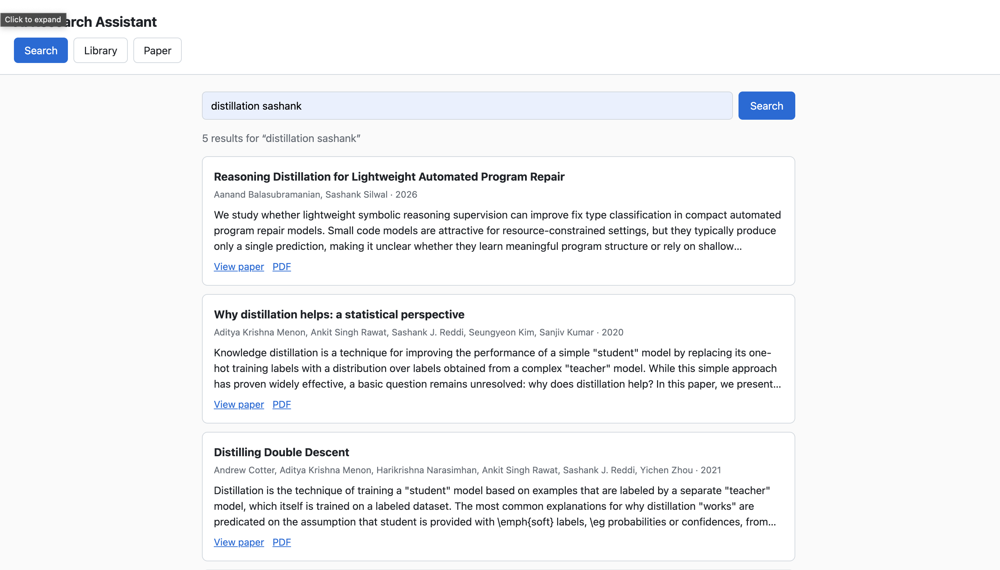
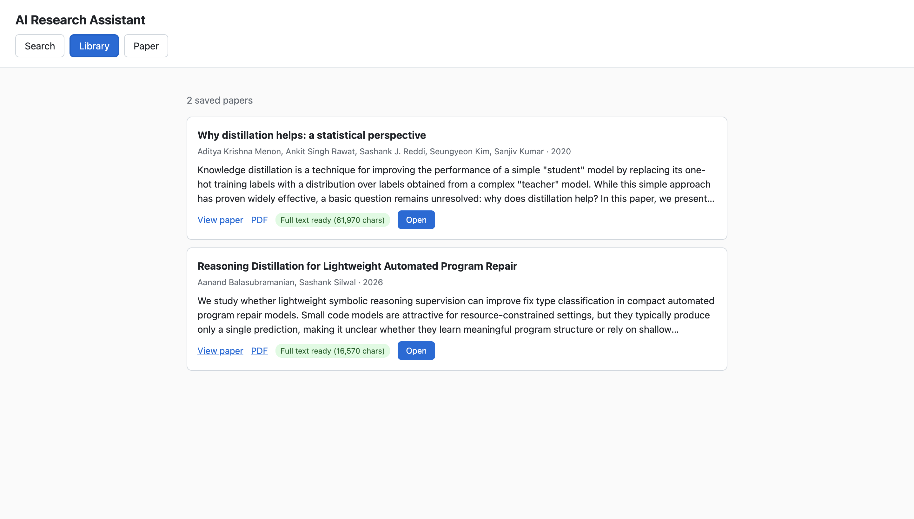
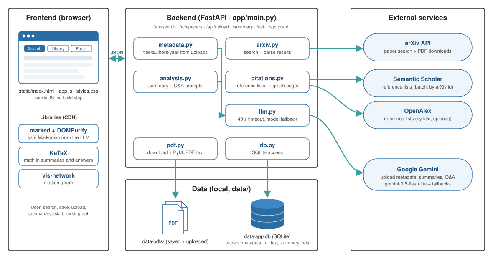

# AI Research Assistant

A small web app for working with research papers: search arXiv, save papers to a local library, upload your own PDFs, and use Google Gemini to summarize a paper or answer questions about it, grounded in the paper's **full text**.

Built for CS593 HW1 using a coding agent (Claude Code). See [`docs/PLAN.md`](docs/PLAN.md) for the plan, [`docs/agent-log.md`](docs/agent-log.md) for the development log (including every test run).



## Features

| Feature | How it works |
|---|---|
| **Search papers** | Keyword/topic search over the arXiv API, with one-click suggested topics. Results show title, authors, year, abstract, and links to the paper page and PDF. Tip: arXiv matches keywords better than exact titles (add an author name for a famous title). |
| **Save to a local library** | "Save to library" stores the paper in SQLite **and downloads its PDF**, extracting the full text. The library survives page refreshes and server restarts. |
| **Upload PDFs** | Upload any paper PDF. Gemini extracts the title, authors, year and abstract from the first pages, so it renders like a search result. Falls back to the PDF's embedded metadata if Gemini is unavailable. |
| **Summarize** | Gemini writes a structured summary (problem, approach, experiments, key results, limitations) from the paper's full text, not just its abstract. The reference list is removed first (appendices are kept). Formulas render with KaTeX. Summaries are cached; "Regenerate" makes a new one. |
| **Ask questions** | Ask anything about a paper, or click one of the example questions. Answers come only from the paper's text; if the paper doesn't say, the answer says so. |
| **Citation graph** *(extra)* | "Show citation graph" in the Library draws your saved papers as an Obsidian-style graph: an arrow A → B when A cites B, dot size by number of links, hover to highlight a paper's links and see its full title, labels for the top-N papers, title search and an "unlinked papers" toggle. Reference lists come from Semantic Scholar (by arXiv id) and OpenAlex (by title, also covers uploads). Click a node to open the paper. |



## Architecture



```
Browser: static/index.html + app.js (vanilla JS; tabs: Search | Library | Paper)
   │ fetch JSON
FastAPI app (app/main.py) — one Python process, also serves the static files
   ├─ app/arxiv.py      arXiv API search → normalized paper dicts
   ├─ app/pdf.py        PDF download + text extraction (PyMuPDF)
   ├─ app/metadata.py   title/authors/year/abstract from uploaded PDFs (Gemini + fallback)
   ├─ app/analysis.py   summary and Q&A prompts over the full text (reference list stripped)
   ├─ app/llm.py        Gemini client: structured output, 40 s per-model timeout, retries, model fallback, readable errors
   ├─ app/citations.py  citation links between library papers (Semantic Scholar + OpenAlex)
   └─ app/db.py         SQLite access
data/app.db (SQLite)  +  data/pdfs/ (saved and uploaded PDFs)     ← created on first run, not in git
```

**How full text is obtained.** Every arXiv result has a free PDF. When you save a search result, the backend downloads that PDF and extracts its text with the same pipeline used for uploads. Papers whose PDF can't be read (e.g. scanned images) get a "Full text unavailable" badge, and summary/Q&A are disabled for them rather than silently falling back to the abstract.

**Tech stack:** Python 3.11, FastAPI, Uvicorn, SQLite, PyMuPDF, httpx, `google-genai` SDK; frontend in plain HTML/CSS/JS, with `marked` + `DOMPurify` (from a CDN) to render the model's Markdown safely, KaTeX for formulas in that output, and `vis-network` for the citation graph.

### External services

| Service | Used for | Key needed | Notes |
|---|---|---|---|
| [arXiv API](https://info.arxiv.org/help/api/index.html) (`export.arxiv.org/api/query`) | Paper search, PDF downloads | No | arXiv asks for ≤1 request every 3 s; interactive use stays well below that. |
| [Semantic Scholar API](https://api.semanticscholar.org/) | Citation graph: reference lists of arXiv papers, fetched for the whole library in one batch request | No | Keyless requests are sometimes rejected (429); the app retries with backoff, falls back to OpenAlex links, and tries again on the next graph load. Results are cached. |
| [OpenAlex API](https://docs.openalex.org/) | Citation graph: matching papers by title (covers uploaded PDFs) and reading their reference lists | No | Lookups are cached per paper in the database. Optional `OPENALEX_EMAIL` gets faster service. |
| [Google Gemini API](https://ai.google.dev/) | Upload metadata extraction, summaries, Q&A | Yes (`GEMINI_API_KEY`) | The free tier has low per-minute limits and occasional "high demand" errors; the app retries and falls back across models (see `GEMINI_FALLBACK_MODELS`). |

## Setup and running

Requirements: Python 3.10+ (developed on 3.11) and a Gemini API key from [Google AI Studio](https://aistudio.google.com/apikey).

```bash
git clone https://github.com/sashanksilwal/ai-research-assistant.git
cd ai-research-assistant

python3.11 -m venv .venv
.venv/bin/pip install -r requirements.txt

cp .env.example .env
# edit .env and set GEMINI_API_KEY=<your key>

.venv/bin/uvicorn app.main:app --reload
```

Open <http://127.0.0.1:8000>. The database and PDF folder are created automatically under `data/` on first run.

Search and the library work without a Gemini key; uploads fall back to the PDF's embedded metadata, and summary/Q&A show an error until a key is set.

### Configuration (`.env`)

| Variable | Default | Purpose |
|---|---|---|
| `GEMINI_API_KEY` | — (required for AI features) | Google AI Studio API key |
| `GEMINI_MODEL` | `gemini-3.5-flash-lite` | Main model (fastest in an Oct 10 comparison: ~3 s per summary) |
| `GEMINI_FALLBACK_MODELS` | `gemini-3.5-flash,gemini-flash-lite-latest,gemini-3.6-flash` | Tried in order when the main model is rate-limited (429), overloaded (503) or gives no answer within 40 s |
| `DATA_DIR` | `data` | Where the SQLite database and PDFs are stored |
| `OPENALEX_EMAIL` | — (optional) | Contact email sent to OpenAlex for its faster "polite pool" |

`.env` is git-ignored; never commit API keys.

## Using the app

1. **Search** tab: enter keywords (e.g. `retrieval augmented generation`) → **Save to library** on any result. Saving takes a few seconds while the PDF downloads.
2. **Library** tab: browse saved and uploaded papers; upload a PDF with the bar at the top; **Show citation graph** to see which saved papers cite each other.
3. **Open** a paper → **Paper** tab: **Summarize with Gemini**, then ask questions in the box or click an example question.

## API

| Method & path | Description |
|---|---|
| `GET /api/search?q=` | Search arXiv (10 results) |
| `POST /api/papers` | Save a search result (downloads PDF, extracts text); returns the existing paper if already saved |
| `POST /api/upload` | Upload a PDF (multipart `file`) |
| `GET /api/papers` | List the library |
| `GET /api/papers/{id}` | One paper (metadata, summary, text status) |
| `GET /api/papers/{id}/pdf` | The stored PDF |
| `POST /api/papers/{id}/summary[?refresh=true]` | Summarize from full text (cached) |
| `POST /api/papers/{id}/ask` | Body `{"question": "..."}` → answer from full text |
| `GET /api/graph` | Citation graph of the library: `{nodes, edges}` |
| `GET /api/health` | Health check |

Interactive API docs are at <http://127.0.0.1:8000/docs> (generated by FastAPI).

## Project structure

```
app/            FastAPI backend (modules described under Architecture)
static/         Frontend: index.html, app.js, styles.css
scripts/spike.py         Feasibility check used before building (arXiv → PDF → text → Gemini)
scripts/record_demo.py   Records the demo video with Playwright (optionally synced to a narration take)
scripts/add_terms.py     Adds on-screen labels to the narrated demo video
docs/           PLAN.md (work plan), agent-log.md (coding-agent log + test results),
                demo-script.md (video narration), screenshots/
railway.json, .python-version   Deployment config for Railway (start command, health check, Python 3.11)
CLAUDE.md       Notes for the coding agent (known mistakes, workflow rules)
requirements.txt, .env.example
```

## Recording the demo video (optional)

The demo was recorded by `scripts/record_demo.py`, which drives the app in headless Chromium (Playwright) and follows [`docs/demo-script.md`](docs/demo-script.md). It needs Playwright and `imageio-ffmpeg`, which are not app dependencies, so install them in a separate environment. Run it against a copy of the data so the demo's save and upload don't change your library:

```bash
cp -R data /tmp/demo-data
DATA_DIR=/tmp/demo-data .venv/bin/uvicorn app.main:app --port 8001
python scripts/record_demo.py --url http://localhost:8001 --pdf self-refine.pdf \
    [--narration voice.m4a --cuts <8 pause times in seconds>]
python scripts/add_terms.py demo-out/demo-narrated.mp4 demo-out/timeline.json --cuts <same> --out demo-final.mp4
```

## Limitations

- Single user, no authentication; not production-hardened.
- Summaries and Q&A send up to ~300,000 characters of a paper to Gemini; longer documents are truncated, and the UI says so.
- Scanned PDFs without a text layer can be stored but not summarized (no OCR).
- Q&A is single-turn: each question is answered independently, and the question history is not saved.
- Search covers arXiv only, with arXiv's relevance ranking.
- Some arXiv abstracts contain raw LaTeX (e.g. `\emph{...}`), shown as-is.
- The citation graph depends on third-party data. Semantic Scholar's keyless API is rate-limited, so the first graph load can take up to a minute or show only OpenAlex links until a later load. OpenAlex's records are incomplete for many recent ML papers (some have no reference list). Uploaded PDFs get incoming links by exact title match only.
- Reference stripping is heuristic: when the "References" heading isn't on its own line, the full text (with references) is sent.
- Gemini models change availability often; on Oct 10, 2026 two models accepted requests and never answered. Each model gets 40 s before the next is tried; change `GEMINI_MODEL` if responses are slow.
