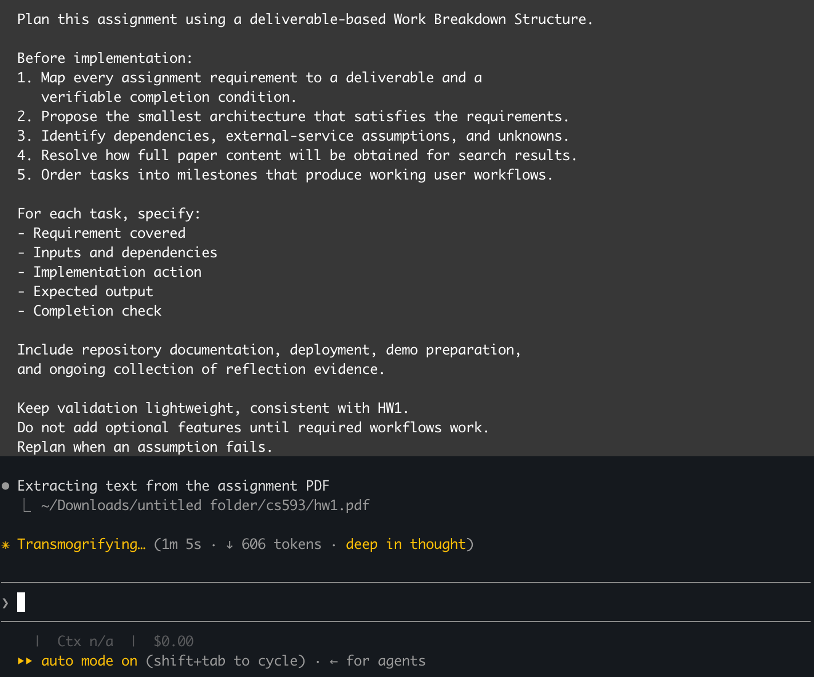
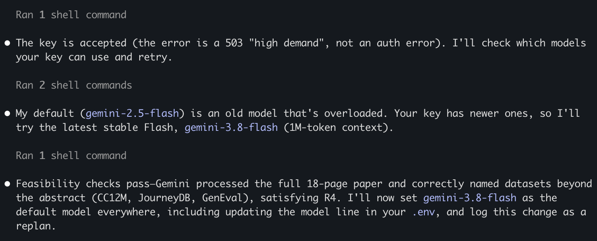
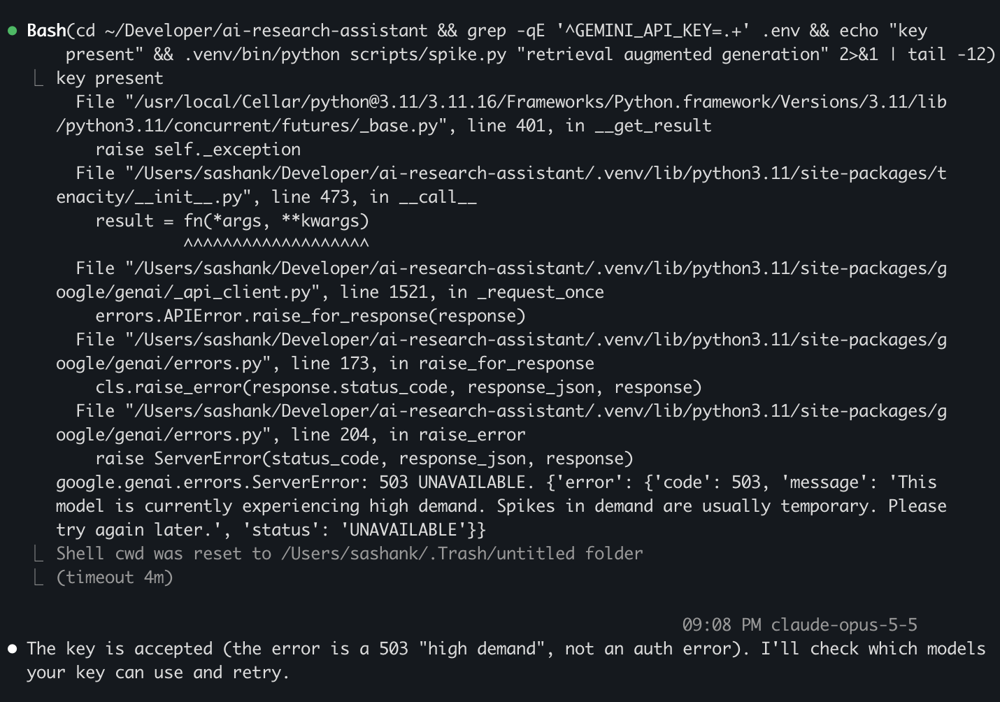
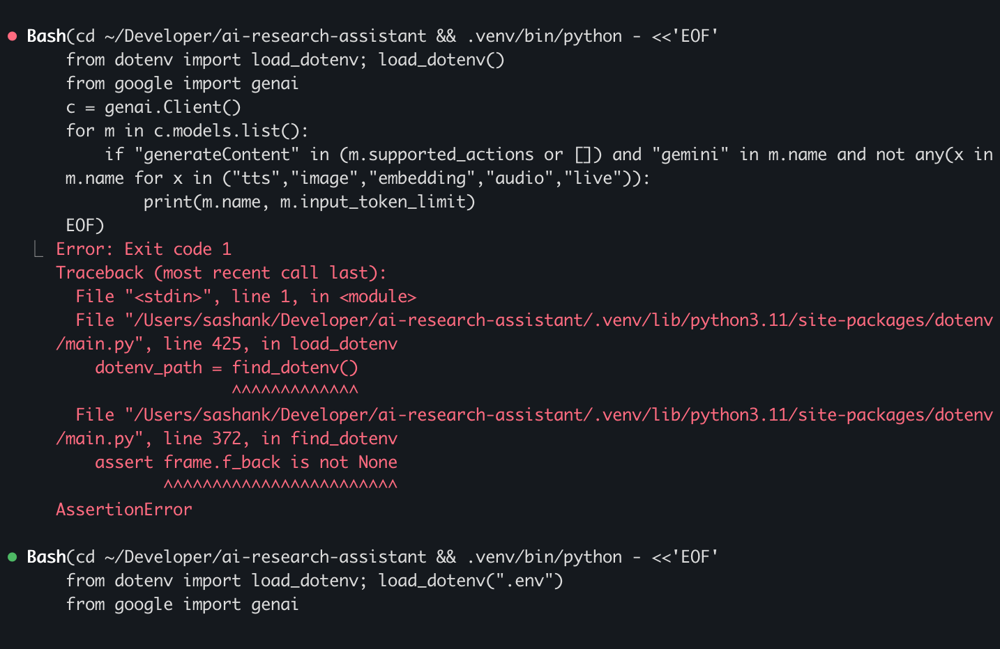
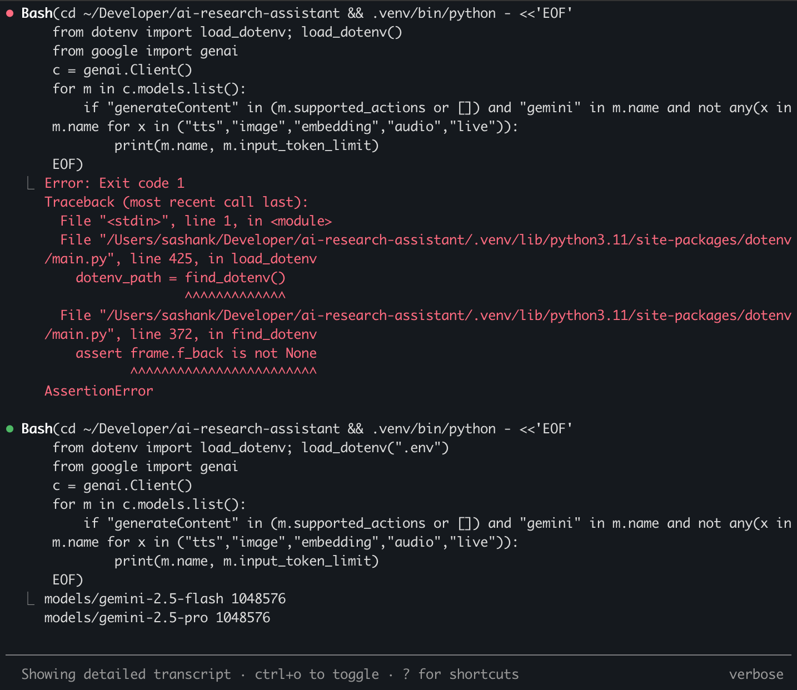

# Coding-Agent Log (reflection evidence)

Agent: Claude Code (model: Claude Opus 5.5), terminal CLI.
Plan: [PLAN.md](PLAN.md) · Project: [README](../README.md)
Format per entry: date · milestone · what I asked · what the agent did · problems / corrections · hand-edits (rough %) · lesson.
Screenshots live in [screenshots/](screenshots/) (name `YYYY-MM-DD-<topic>-N.png`).

---

## 2026-10-02 · Planning
- **Asked:** read hw1.pdf, plan with a deliverable-based WBS (requirement map, smallest architecture, dependencies/unknowns, how full paper text is obtained, milestones with completion checks).
- **Agent did:** extracted the PDF (pdftotext/pypdf missing → fell back to its built-in PDF reader), produced [PLAN.md](PLAN.md); picked arXiv specifically because every result has a PDF, so summaries can use full text (R4).
- **My decisions:** Claude API (later switched to Gemini, see M0); FastAPI + vanilla JS + SQLite; plan deployment; repo in `~/Developer`.
- **Problems / corrections:** none yet. Note: the agent flagged that its session was running from `~/.Trash/...` and asked where the repo should live.
- **Lesson:** asking for "completion checks" per task forced concrete, testable steps instead of vague TODOs.

My WBS planning prompt:

## 2026-10-02 · M0 Foundations
- **Asked:** "do it" (execute M0 from [PLAN.md](PLAN.md)).
- **Agent did:** git repo + Python 3.11 venv, `.gitignore`/`.env.example`/`requirements.txt`, FastAPI skeleton (3 tabs, `/api/health`, SQLite `papers` table), feasibility spike script.
- **Mid-task change:** I switched the LLM from Claude to Gemini while the agent was writing the spike. It swapped the SDK, rewrote the spike's LLM step, and recorded the change in the [PLAN.md replan log](PLAN.md#replan-log). (Evidence for Q5: changing requirements mid-task.)
- **Small agent slip:** its sed-based edit left a duplicate `import os` and used the deprecated `fitz` import (PyMuPDF printed a deprecation warning); it noticed and fixed both on the next step.
- **Spike results:** arXiv search ✓, PDF download ✓, text extraction ✓ (68,792 chars / 18 pages), Gemini ✓ (18k-token full paper).
- **Agent mistake → fix:** the agent defaulted to `gemini-2.5-flash` from its own training-era knowledge; the call failed with 503 "high demand". Instead of retrying blindly it listed the models my key can access, found newer ones (up to 3.8 Flash), and switched. Lesson: agent's model knowledge can be stale; verify against the live API. Also hit a `python-dotenv` `find_dotenv()` assertion when running from stdin; fixed by passing the path explicitly.
- **Hand-edits:** 0% so far.

Overview — 503 → list models → switch to 3.8 Flash (collapsed view):

The 503 error, expanded:

`load_dotenv()` crash → fixed with explicit path:

Start of the model list:

_TODO: rest of model list (down to gemini-3.8-flash); the "we will use gemini" message._
