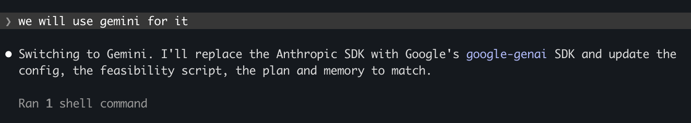
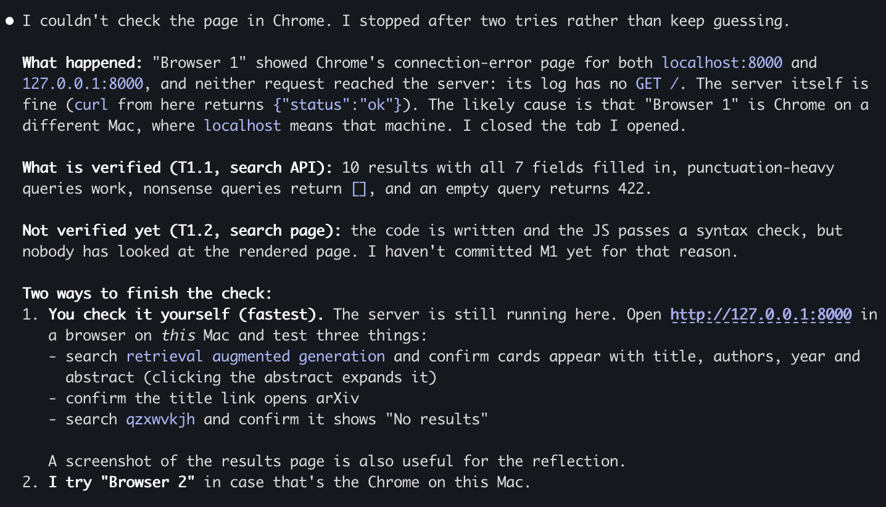
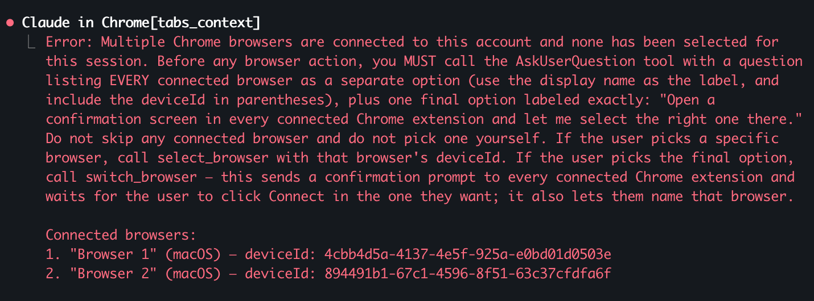
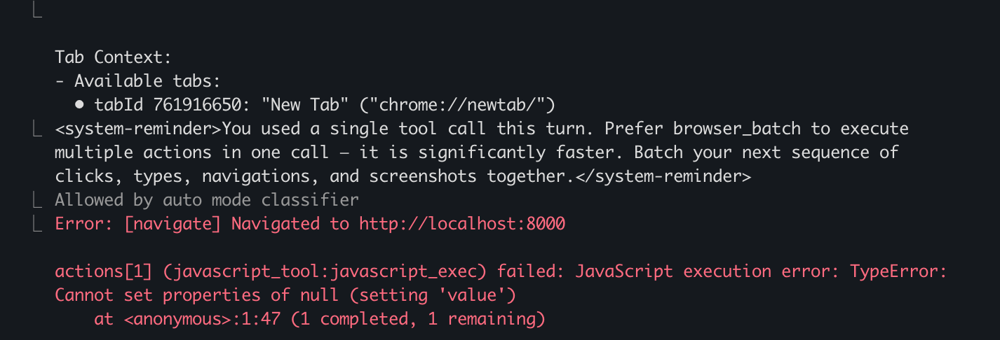
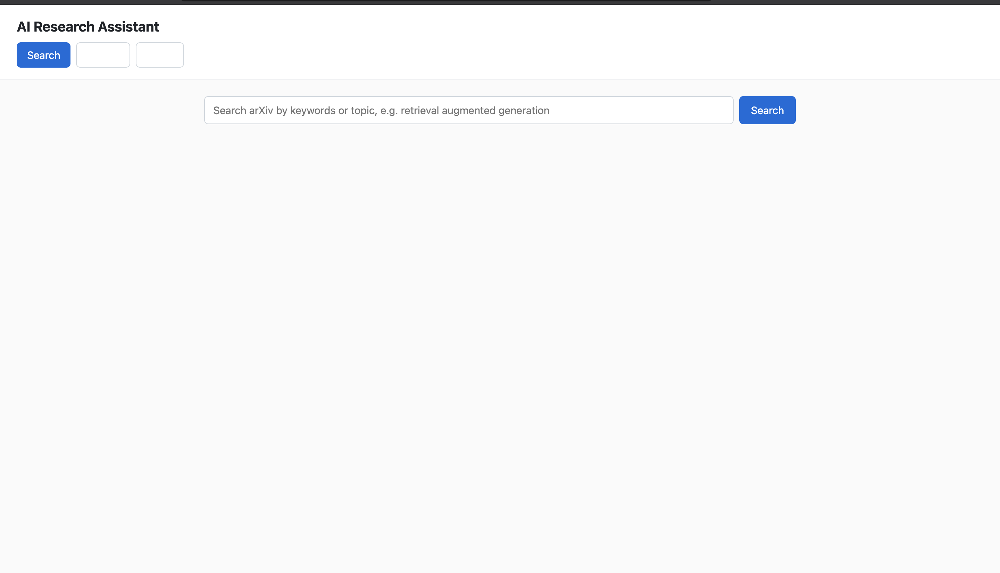

# Coding-Agent Log (reflection evidence)

Agent: Claude Code (model: Claude Opus 5.5), terminal CLI.
Plan: [PLAN.md](PLAN.md) · Project: [README](../README.md)
Format per entry: date · milestone · what I asked · what the agent did · problems / corrections · hand-edits (rough %) · lesson.
Screenshots live in `docs/screenshots/` and are embedded below (name `YYYY-MM-DD-<topic>-N.png`).

---

## 2026-10-02 · Planning
- **Asked:** read hw1.pdf, plan with a deliverable-based WBS (requirement map, smallest architecture, dependencies/unknowns, how full paper text is obtained, milestones with completion checks).
- **Agent did:** extracted the PDF (pdftotext/pypdf missing → fell back to its built-in PDF reader), produced [PLAN.md](PLAN.md); picked arXiv specifically because every result has a PDF, so summaries can use full text (R4).
- **My decisions:** Claude API (later switched to Gemini, see M0); FastAPI + vanilla JS + SQLite; plan deployment; repo in `~/Developer`.
- **Problems / corrections:** none yet. Note: the agent flagged that its session was running from `~/.Trash/...` and asked where the repo should live.
- **Lesson:** asking for "completion checks" per task forced concrete, testable steps instead of vague TODOs.

My WBS planning prompt:

## 2026-10-02 · M0 Foundations
- **Asked:** "do it" (execute M0 from [PLAN.md](PLAN.md)).
- **Agent did:** git repo + Python 3.11 venv, `.gitignore`/`.env.example`/`requirements.txt`, FastAPI skeleton (3 tabs, `/api/health`, SQLite `papers` table), feasibility spike script.
- **Mid-task change:** I switched the LLM from Claude to Gemini while the agent was writing the spike. It swapped the SDK, rewrote the spike's LLM step, and recorded the change in the [PLAN.md replan log](PLAN.md#replan-log). (Evidence for Q5: changing requirements mid-task.)
- **Small agent slip:** its sed-based edit left a duplicate `import os` and used the deprecated `fitz` import (PyMuPDF printed a deprecation warning); it noticed and fixed both on the next step.
- **Spike results:** arXiv search ✓, PDF download ✓, text extraction ✓ (68,792 chars / 18 pages), Gemini ✓ (18k-token full paper).
- **Agent mistake → fix:** the agent defaulted to `gemini-2.5-flash` from its own training-era knowledge; the call failed with 503 "high demand". Instead of retrying blindly it listed the models my key can access, found newer ones (up to 3.8 Flash), and switched. Lesson: agent's model knowledge can be stale; verify against the live API. Also hit a `python-dotenv` `find_dotenv()` assertion when running from stdin; fixed by passing the path explicitly.
- **Hand-edits:** 0% so far.

Overview — 503 → list models → switch to 3.8 Flash (collapsed view):

The 503 error, expanded:

`load_dotenv()` crash → fixed with explicit path:

Start of the model list:

_(The rest of the model list, down to `gemini-3.8-flash`, was not captured; the text above records the switch.)_

My mid-task switch to Gemini:

## 2026-10-02 · M1 Search ✓
- **Asked:** "yes" (start M1 from [PLAN.md](PLAN.md)).
- **Agent did:** `app/arxiv.py` (query builder that ANDs keywords and strips arXiv query syntax; Atom parsing; version-less arXiv id for de-duplication), `GET /api/search`, search page with a shared `renderPaperCard()` reused later by the library.
- **API check (T1.1) ✓:** 10 results, all 7 fields non-empty; punctuation query works; nonsense query → `[]`; empty query → 422.
- **Agent limitation:** the agent tried to verify the UI itself through the Claude-in-Chrome extension. Two Chrome browsers were connected to my account; it asked me to pick one, but the one I picked could not reach `localhost:8000` (requests never hit the server log — probably a browser on another machine). After two attempts it stopped, closed its tab, and handed the visual check back to me instead of claiming the UI worked. It also kept M1 uncommitted until the page is checked. (Q4: I still have to verify UI myself.)

Agent's summary of the failed browser check:

Extension asked which of two connected browsers to use:

The navigation landed on Chrome's error page, so the page script failed:

- **Agent bug found by me (Q3):** after M1, the inactive tab buttons ("Library", "Paper") were blank. Cause: the agent added a global `button { color: #fff }` style for the new Search button, which the tab buttons inherited → white text on white background. The agent had only syntax-checked the JS and never saw the page rendered (its browser check failed, see above), so it missed this. Fix: explicit `color` on `.tab`. Lesson: CSS side effects are invisible to non-visual checks; a human look at the page caught it immediately.

  Blank "Library" / "Paper" tabs (white text on white):
  

- **UI check (T1.2) ✓ — done by me in my own browser:** query "distillation sashank" → 5 cards with title, authors, year, abstract, View paper / PDF links; tabs readable after the fix. Noted (not fixed, optional): some arXiv abstracts contain raw LaTeX like `\emph{soft}`.
- **Hand-edits:** 0% of code; my contribution was the visual check and spotting the CSS bug.

M1 search results (my check in my own browser):

## 2026-10-02 · M2 Library ✓
- **Asked:** continue to M2 (save → library → detail).
- **Agent did:** `app/pdf.py` (download + text extraction, rejects non-PDF responses and text-less scans), `POST /api/papers` (dedupes on arXiv id, downloads the PDF, stores full text), `GET /api/papers`, `GET /api/papers/{id}`, `GET /api/papers/{id}/pdf`; Save button on search cards, Library tab with a "full text ready / unavailable" badge, Paper tab.
- **Bugs during M2, all caught by the completion checks before I saw the UI:**
  1. **Repeated mistake:** server failed to start — `SyntaxError: f-string expression part cannot include a backslash` (a regex `\w` inside an f-string; not allowed before Python 3.12). The agent had made *the same mistake* earlier in the status-line script. It only noticed because every test request failed; it then read the server log. Lesson: the agent doesn't learn within a session unless the lesson is written down.
  2. **Search bug (pre-existing from M1):** `attention is all you need` returned **0 results**. Agent tested raw arXiv queries and confirmed ANDing stopwords (`all:is`) matches nothing. Fix: drop stopwords from the query. My M1 check had used keyword-only queries, so it never exercised this.
  3. **Data quirk:** one saved paper reported 6,783 chars for a 21-page PDF. Agent compared Python vs SQLite lengths: full text (61,973 chars) was stored, but the PDF contained NUL characters and SQLite's `length()` stops at the first one. Fix: strip NULs at extraction; repaired the stored row.
- **API checks (T2.1) ✓:** saved paper has 16,570 chars of text vs 1,247-char abstract; re-save returns the same id; PDF served from `/api/papers/{id}/pdf`; bad PDF URL → saved with `text_status=failed` and a reason; 3 papers still present after server restart.
- **Hand-edits:** 0%.
- **UI check (T2.2/T2.3) ✓ — by me:** saved papers appear in the Library tab with "Full text ready" badges (61,970 and 16,570 chars), Open → Paper tab works.

  Library with two saved papers and full-text badges:
  
- **My correction → making the lesson stick (Q5):** I told the agent to *note the error it had and missed* (the repeated f-string backslash bug). It added a repo `CLAUDE.md` — which Claude Code loads automatically every session — with a "known agent mistakes" section and a rule to import-check Python before restarting the server. Lesson: an agent only "remembers" a correction if it's written into the context it reads every time.

## 2026-10-02 · M3 Upload (in progress)
- **Asked:** "yes" (start M3).
- **Agent did:** `app/llm.py` (Gemini client: structured JSON output, readable errors, retry + fallback across models), `app/metadata.py` (Gemini extracts title/authors/year/abstract from the first ~8k chars; heuristic fallback from PDF metadata + "Abstract" heading), `POST /api/upload` (rejects non-PDFs, keeps text-less scans with a "failed" badge), upload form + source badges in the Library tab.
- **Tested on 3 real layouts:** BERT (ACL), Dropout (JMLR), my own arXiv paper — plus a text-less "scanned" PDF and a fake `.pdf` (400).
- **Assumption failed again (A3), measured instead of guessed:** 2 of 3 uploads hit Gemini 503 and fell back to weak heuristics (title = filename). The agent ran 5 calls per model: `gemini-3.8-flash` 3 ok then 429 (free-tier per-minute limit), `gemini-3.5-flash` 503 ×3, `gemini-flash-latest` 5/5 ok. Since limits are per model, it added fallback across models + one delayed retry. Rerun: Dropout and my paper extracted by Gemini; BERT still got all-503 for ~20 s but the fallback recovered correct title/authors/year from the PDF's embedded metadata.
- **"Bug" that wasn't:** my paper came back with no abstract. Agent checked page 1: the PDF genuinely has no abstract section (only arXiv's listing has one), and Gemini correctly returned null as instructed instead of inventing one.
- **Agent slips:** (1) fallback abstract kept line-break hyphenation ("representa- tion") → fixed + repaired stored row. (2) An agent edit script crashed with a `SyntaxError` before writing anything, but the follow-up `checks-ok` still printed because it checked the *unchanged* files — a misleading green light. The agent caught it from the traceback, confirmed nothing was written, redid the edit with its Edit tool, and then verified the *served* files contained the change. Lesson: "the checks passed" only means something if they check the thing you changed.
- **Scope request (Q5):** mid-M3 I asked for a citation graph of saved papers. The agent pointed out it conflicts with my own "no optional features until required workflows work" rule and added it to PLAN.md as backlog item #1 after M4 instead of building it immediately.
- **UI check (T3.3): pending** — deferred by me; I asked the agent to stop calling Gemini and continue, and I will test M3+M4 together.

## 2026-10-02 · M4 Summary + Q&A (built; live test pending)
- **Constraint I set:** "for now don't use the Gemini API, just continue; I'll tell you and then we test." The agent committed M3 as "UI check pending" and kept building.
- **Agent did:** `app/analysis.py` (summary prompt with Problem / Approach / Experiments / Key results / Limitations sections; Q&A prompt that answers only from the paper and says "The paper doesn't say" otherwise; paper text first, instructions/question last; 300k-char cap reported as `truncated`, never silent), `POST /api/papers/{id}/summary` (cached in DB, `?refresh=true` regenerates), `POST /api/papers/{id}/ask`; Paper tab with Summarize/Regenerate button, question box (Enter to send), one-click chips for the 5 example questions from the assignment, Markdown rendering via marked + DOMPurify.
- **How it was tested without Gemini:** the agent replaced `llm.generate` with a fake that records the prompt and returns canned text, against a throwaway temp database. 11 checks passed: full text (a marker planted 50k chars deep) reaches the prompt and the abstract alone is never used (R4); summary cached and refreshable; question placed after the paper with the "only the paper" system prompt (R5); 409 for papers without full text; 404 / 422 for bad input; huge paper truncated and flagged; Gemini outage → readable 503. **0 real API calls.**
- **Not yet verified:** real Gemini output quality and the rendered UI — scheduled for my combined M3+M4 test.
